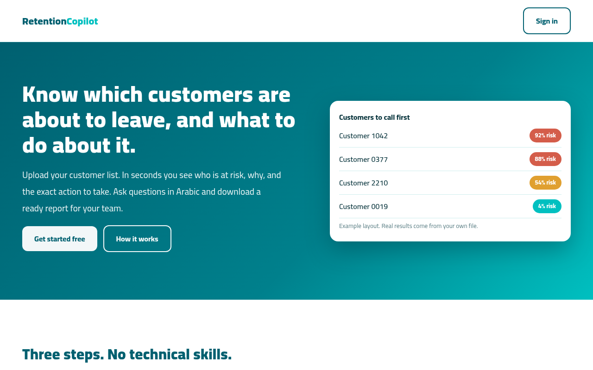
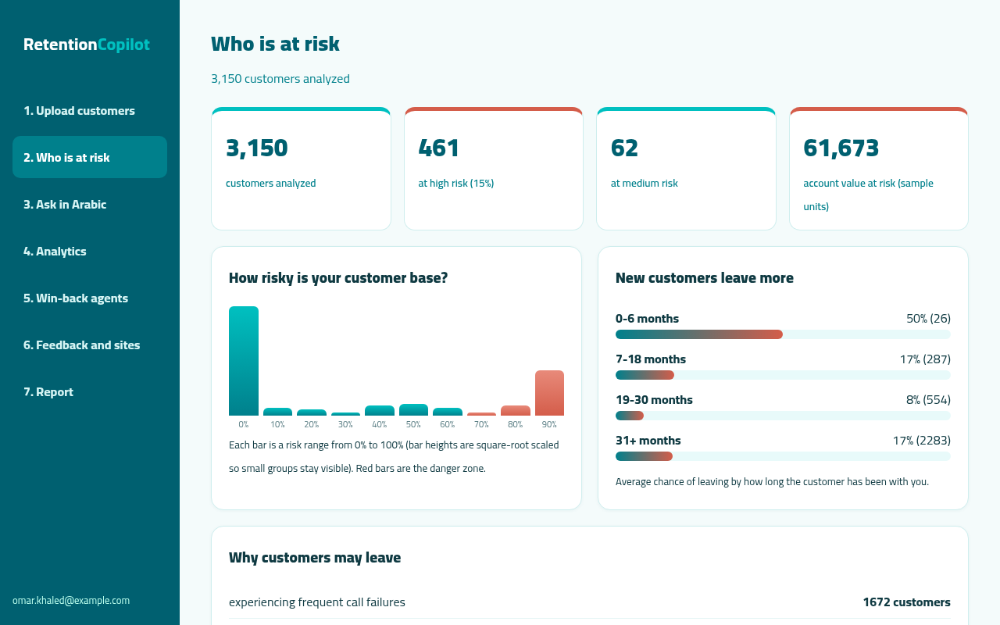
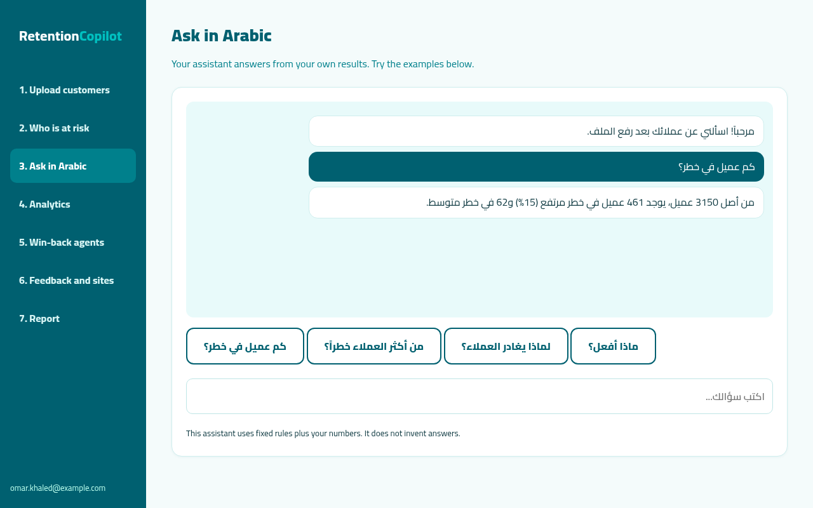
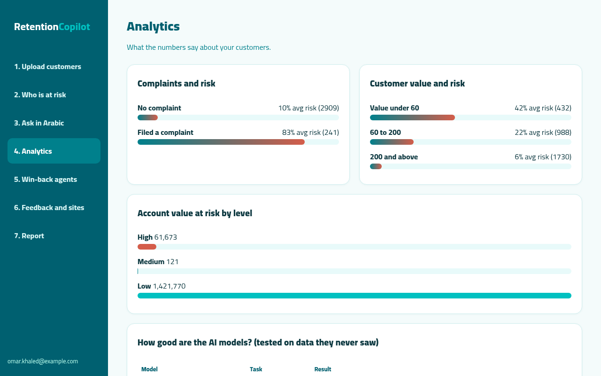
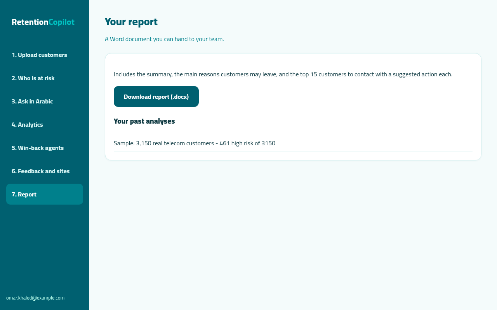

# Retention Copilot

A small web product that answers one business question: **which customers are about to leave, why, and what should we do?**

**Live demo:** [retention-copilot-production.up.railway.app](https://retention-copilot-production.up.railway.app/) (free tier: sleeps when idle, so the first load can take a few seconds; LLM off, data resets on restart).

**Demo:** [Screenshot walkthrough on Hugging Face Spaces](https://huggingface.co/spaces/mostafaabdo2003ai/retention-copilot-walkthrough) (screenshots of the real app on the sample data, not a live app; run it yourself with the steps below).

User journey: landing page -> create account / sign in -> upload a customer CSV (or use the 3,150-customer sample) -> dashboard (risk levels, risk by tenure, main reasons, contact list with suggested actions) -> Arabic assistant -> downloadable Word report.

## Screenshots
Real captures of the app running locally on the public 3,150-customer sample, with the language-model features off. The signed-in user is a fictional sample account.

| | |
|---|---|
|  |  |
| Landing page | Who is at risk: counts, risk distribution, tenure effect, main reasons |
|  |  |
| Arabic assistant (fixed rules plus the computed numbers) | Analytics: complaints, customer value, value at risk |
|  | |
| Downloadable Word report | |

## Works with any churn CSV
Upload a CSV with a column that says who left (Yes/No or 1/0). If it is not the Iranian-telecom layout, the app asks you to pick that column (plus optional id, tenure and value columns), trains a gradient boosting model on your file, and shows risk scores. The Iranian sample and its pre-trained model still work as before.

Measured (local run, 25% of rows held out, a majority-guess baseline for comparison):

| Dataset | Rows | Held-out accuracy | Majority baseline | ROC-AUC | Time |
|---|---|---|---|---|---|
| IBM Telco Customer Churn (Apache-2.0) | 7,043 | 78.4% | 73.5% | 0.830 | about 6 s |
| UCI Iranian churn, through the general path | 3,150 | 96.6% | 84.3% | 0.992 | about 3 s |

How it works and where it is limited:
- The per-customer risk shown comes from 5-fold cross-validation, so each customer is scored by a model that never saw them.
- "Why" lines are churn rates measured in your file for the top inputs. They show patterns, not proof of cause, and are not SHAP.
- Suggested actions in this mode are generic by risk band. The tailored actions and the Arabic win-back agents were written for the Iranian layout.
- Needs 200+ customers with a known outcome, at least 30 in each group, at most 20,000 rows. Free text and columns with more than 30 distinct values are skipped, and columns named like churn score or churn reason are left out as leakage.
- A 20,000-row file took about 12 s and 240 MB peak memory locally. It has not been timed on the free Railway tier (0.5 GB RAM).
- Bad files return a plain error message on the page instead of a crash. Tests are in `tests/test_generic.py`. The IBM file is not stored in this repo: https://raw.githubusercontent.com/IBM/telco-customer-churn-on-icp4d/master/data/Telco-Customer-Churn.csv

## What is real
- ML model: gradient boosting trained on the public Iranian Churn dataset (UCI #563, 3,150 customers). Held-out ROC-AUC 0.992, accuracy 96.3% (see the churn-insight-platform repo for the benchmark).
- Accounts and run history in a real database (SQLite locally, Postgres with docker compose), with SQL migrations. Passwords are salted PBKDF2 hashes.
- DOCX report generated from your results.

## AI modules (all run in this repo)
| Module | Domain | Model / data | Honest result |
|---|---|---|---|
| Churn risk | ML | Gradient boosting, Iranian Churn (UCI 563, 3,150 customers) | 96.3% acc, AUC 0.9924 (held-out) |
| Churn risk (DL) | Deep learning | PyTorch MLP, same data, threshold chosen on a validation slice | 97.0% acc, AUC 0.9872 on 630 unseen customers (`scripts/train_dl.py`). Different split from the row above; on that same split gradient boosting scores 96.35% / AUC 0.993, so the MLP is higher on accuracy (tuned threshold) but lower on AUC |
| Comment reader | Arabic NLP | CAMeLBERT-MSA sentiment (public model, used as-is) + keyword topics | 73.7% on 1,000 unseen Arabic restaurant reviews (it also answers "neutral", which counts as wrong); 82.7% when it picks a side. A TF-IDF logistic regression trained on the same reviews gets 86.5% but only knows restaurants (`scripts/eval_nlp.py`) |
| Branch site check | Computer vision | ResNet18 fine-tuned on EuroSAT (from sat-vision-service) | 94.0% on the 2,161 held-out tiles of sat-vision-service (`scripts/eval_vision.py`; that split was also used to pick the training recipe, so slightly optimistic) |
| Win-back agents | Multi-agent + GenAI | KMeans Segmenter, rule Strategist, Qwen2.5-0.5B-Instruct Copywriter, rule Critic, Planner | The 0.5B model writes weak Arabic. The Critic rejected all 3 of its drafts in the sample run and the safe template was used. Use a larger model with `LLM_MODEL=...` for better drafts |
| Analytics | Data analytics | Segment tables from the scored customers | computed live |

Notes: the EuroSAT "test" parquet overlaps the pooled training data, so it is not used for evaluation. Memory: running every model in one process needs about 2 GB RAM. The campaign step takes about 1.5 minutes on a small CPU box.

## What is rule-based (not AI-generated)
- The plain-language reasons and actions are fixed rules over the model's known top drivers, not per-customer SHAP.
- The Arabic assistant matches question intents and fills templated Arabic answers with your numbers. No LLM is called.

## Run
    pip install -r requirements.txt
    python -m pytest -q
    uvicorn src.api:app --port 8000        # open http://localhost:8000
    docker compose up --build              # app + Postgres

## Deploy
The Dockerfile reads $PORT and defaults to 7860, so it deploys as-is to Hugging Face Spaces (Docker SDK) or Render.

Design: logo palette; Cairo (free) for headings. The Riyad Bank typeface is proprietary, so Cairo Black stands in for bold wide titles.

Built with AI pair-programming; numbers come from real runs.

## Files not in this repo
The Arabic reviews parquet is not committed. Run `python scripts/fetch_models.py` to download it and the models (public Hugging Face sources).

## Hosted LLM (real API call)
Win-back messages are drafted by a hosted LLM when `LLM_API_KEY` is set in the environment (never committed). Default: Google Gemini API free tier through its OpenAI-compatible endpoint (`LLM_BASE_URL`, `LLM_HOSTED_MODEL`, default `gemini-3.1-flash-lite`). Order: hosted LLM, then the local Qwen2.5-0.5B (`ENABLE_LLM=1`), then the template. Every draft passes the Critic checks (Arabic, length, no discount or percentage promised).

Measured run (Nov 26, 2026, free tier, 300 high-risk customers in 3 segments): 3 of 3 drafts came from the hosted model and passed the Critic; one call took 0.7 s, others 4 to 14 s in the campaign run, one standalone call 17 s, so expect variable latency on the free tier. The test-suite runs without a key and checks the template path.
